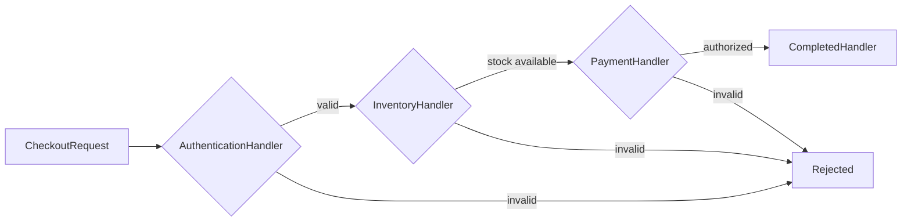

# Bolivar Design Patterns — Python

> **Hands-on design patterns study lab.** A growing Python repository for learning, implementing, testing and comparing Gang of Four (GoF) design patterns. Each pattern lives in a dedicated package with runnable examples and focused tests. The first pattern is **Chain of Responsibility**.

[](https://github.com/bolivarmardegan/design-patterns-python/actions/workflows/ci.yml)

## Purpose

Move beyond pattern definitions: implement each pattern from scratch, identify the problem it solves, explore trade-offs, inspect runtime behavior with breakpoints, and test edge cases. These samples are intentionally small and self-contained: no credentials, no AWS accounts, no real payment integrations.

## Pattern catalog

| Category | Pattern | Status | Demo |
|---|---|---|---|
| Behavioral | Chain of Responsibility | **Implemented** | Checkout validation (authentication → inventory → payment → completion) |
| Behavioral | Strategy, Observer, Command | Planned | Independent packages |
| Creational | Factory Method, Builder | Planned | Independent packages |
| Structural | Adapter, Decorator | Planned | Independent packages |

## Chain of Responsibility

### Intent

Pass a request through a chain of handlers. Each handler either handles the request and stops or delegates to the next handler. This sample uses **ordered validation (fail-fast)**: each handler checks a condition and passes only successful requests downstream.

### Problem

An e-commerce checkout needs ordered authentication, inventory and payment checks. One monolithic `if` sequence mixes responsibilities, is harder to reorder and harder to test independently. The chain isolates steps and lets the client depend only on `Handler`.

### Execution path



**Note:** Payment is simulated by an input boolean; this is not a real payment gateway and is not a security/authentication implementation. Inventory is also simulated by request fields; this example does not reserve stock transactionally.

### Project structure

```text
src/bolivar_design_patterns/
  behavioral/chain_of_responsibility/
    models.py
    handlers.py
    chain.py
    demo.py
tests/test_chain_of_responsibility.py
```

### Requirements

- Python 3.11+
- `pytest` for tests, `ruff` for lint (dev dependencies)

### Run locally

```bash
python3 -m venv .venv
source .venv/bin/activate
python -m pip install -e '.[dev]'
python -m pytest -q
python -m ruff check src tests
python -m bolivar_design_patterns.behavioral.chain_of_responsibility.demo
```

Expected results: an accepted request plus a rejection at the inventory stage.

### Explain the code

1. `CheckoutRequest` — frozen dataclass holding request input.
2. `Decision` — frozen dataclass for the result and stopping stage.
3. `Handler` — ABC defining the `handle()` contract.
4. `ForwardingHandler` — requires the next handler; delegates with `_forward()`.
5. `AuthenticationHandler` — rejects empty identifiers (example only, not real identity validation).
6. `InventoryHandler` — rejects invalid quantities or insufficient stock.
7. `PaymentHandler` — checks only a simulated payment authorization flag.
8. `CompletedHandler` — explicit final approval.
9. `build_checkout_chain` — composition root, defines handler order.

### Tests

`pytest` checks successful processing, short-circuiting at each stage, empty identifiers, zero quantity, failed authorization, invalid amounts and chain reuse. GitHub Actions tests Python 3.11, 3.12 and 3.13 and runs Ruff lint.

### Trade-offs

- **Benefits:** Single Responsibility, Open/Closed extension, configurable order, small independent tests.
- **Costs:** Hidden execution flow if the order is not explicit; debugging across handlers; risk of unhandled requests if no terminal/default behavior is defined.
- **Not for:** a fixed single operation where a normal function call is clearer.

### Suggested exercises

- Add `FraudCheckHandler` and new tests.
- Add diagnostic tracing of handlers (without logging secrets).
- Compare fail-fast validation with the alternative **first matching handler wins** variant.
- Refactor the chain builder to accept configurable sets of checks.

## Learning resources

- [Refactoring.Guru — Chain of Responsibility](https://refactoring.guru/design-patterns/chain-of-responsibility)
- [Refactoring.Guru — Python example](https://refactoring.guru/design-patterns/chain-of-responsibility/python/example)
- [Python `abc` standard documentation](https://docs.python.org/3/library/abc.html)

## Companion Java implementation

[design-patterns-java](https://github.com/bolivarmardegan/design-patterns-java) — same scenario, same decision semantics, different language idioms.

## License

MIT. See [LICENSE](LICENSE).
